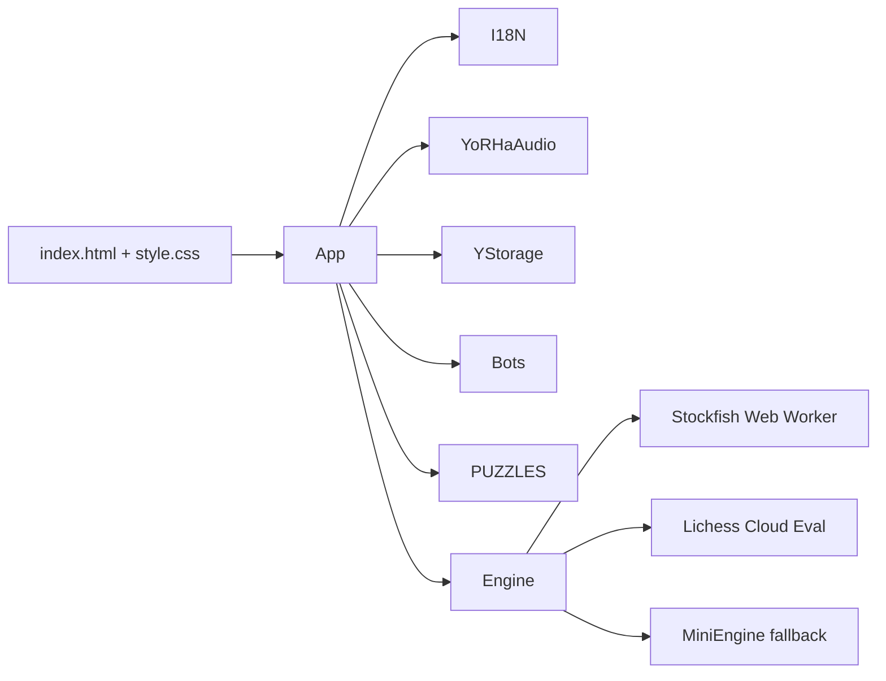

# YoRHa Tactical Chess System — HANDOVER BLUEPRINT

> Single source of truth. Any agent (Claude Opus / Gemini Argon) continuing this project MUST read this file first
> and keep the checklist updated after finishing each module.

---

## 0. Execution Checklist

| # | File | Status | Notes |
|---|------|--------|-------|
| 1 | `HANDOVER_BLUEPRINT.md` | [x] Completed | This file |
| 2 | `index.html` | [x] Completed | Landing Main Menu (`#screen-menu`), 2-col Game Workspace (`#screen-game`), NieR `.popupSection` modals, custom favicon |
| 3 | `style.css` | [x] Completed | Authentic CDN NieR theme (`#ccc6b0` 5px grid, `.coreSystem`, `.section`, `.themebutton`, `.popupSection`) + CRT scanlines/phosphor blur |
| 4 | `i18n.js` | [x] Completed | Standard Chess.com-style `vi` + `en` localization, SAN move notation, zero game lore |
| 5 | `engine.js` | [x] Completed | `Engine` global: worker, cloud eval, classifier, SAN commentary (`describeMove` returns pure SAN) |
| 6 | `app.js` | [x] Completed | `App` global: menu/game routing, desktop drag-and-drop, `0.2s` piece slide animation, collapsible analysis, pawn promotion fix |
| 7 | `audio.js` | [x] Completed | `YoRHaAudio` global: CDN `.ogg` UI sounds, `fortress-of-lies-the-bunker.ogg` BGM, realistic wooden chess piece synthesis |
| 8 | `bots.js` | [x] Completed | `Bots` global: 7 standard chess engine tiers (400–2850 Elo), classical chess piece SVG emblems, pure chess dialogues |
| 9 | `storage.js` | [x] Completed | `YStorage` global: profile, BGM/audio settings, archive, `.json` export/import |
| 10 | `puzzles.js` | [x] Completed | `PUZZLES`, `PUZZLE_CATEGORIES` globals (100 verified puzzles across 4 categories) |

Status legend: `[ ] Pending`, `[~] In Progress`, `[x] Completed`.

---

## 1. Runtime Architecture

* Pure static site, **no build step, no ES modules** (must run from `file://` and any static host).
  All modules are classic `<script>` tags exposing ONE global each.
* External libraries (CDN, with local fallback attempt):
  * `chess.js 0.10.3` (global `Chess`, snake_case API: `in_check()`, `in_checkmate()`, `game_over()`, `moves({verbose:true})`, …)
    – CDN `https://cdnjs.cloudflare.com/ajax/libs/chess.js/0.10.3/chess.min.js`, local fallback `vendor/chess.min.js`.
  * `stockfish.js 10.0.2` (asm.js build) loaded **inside a Blob Web Worker** via `importScripts(...)`
    – `https://cdnjs.cloudflare.com/ajax/libs/stockfish.js/10.0.2/stockfish.js`. If the worker fails → built-in `MiniEngine`
    (JS alpha-beta, depth 2–3) inside `engine.js` so the app never dead-locks offline.
* Script load order in `index.html` (end of body):
  `chess.js → i18n.js → audio.js → storage.js → bots.js → puzzles.js → engine.js → app.js`
* `App.init()` is invoked on `DOMContentLoaded` by `app.js` itself.



---

## 2. Module Contracts & API Signatures

### 2.1 `i18n.js` → global `I18N`
```js
I18N.lang                         // 'vi' | 'en'   (default 'vi')
I18N.dict                         // { vi:{key:str}, en:{key:str} }
I18N.t(key, params?)              // string; '{name}' placeholders replaced from params; falls back en → key
I18N.setLang(lang)                // persists via YStorage settings if available, re-applies DOM, fires listeners
I18N.apply(root = document)       // fills [data-i18n] textContent, [data-i18n-title] title,
                                  // [data-i18n-placeholder] placeholder, [data-i18n-html] innerHTML
I18N.onChange(cb)                 // cb(lang) after each setLang
I18N.pick(obj)                    // obj = {vi,en} → string in active language (fallback en)
I18N.pieceName(type)              // 'p'|'n'|'b'|'r'|'q'|'k' → localized noun ("Mã" / "Knight")
I18N.classLabel(cls)              // classification key → localized label
I18N.CLASS_SYMBOL                 // { brilliant:'!!', best:'★', great:'!', book:'BOOK', good:'GOOD',
                                  //   inaccuracy:'?!', mistake:'?', blunder:'??' }
```
Key namespaces: `ui.*`, `mode.*`, `btn.*`, `status.*`, `cls.*`, `coach.*` (commentary templates), `review.*`,
`puzzle.*`, `cat.*`, `settings.*`, `profile.*`, `archive.*`, `alert.*`, `tc.*`, `piece.*`.

### 2.2 `audio.js` → global `YoRHaAudio`
```js
YoRHaAudio.init()                 // lazily creates AudioContext on first user gesture (safe to call repeatedly)
YoRHaAudio.play(name)             // names: 'click','hover','confirm','cancel','move','capture','castle',
                                  //        'check','promote','blunder','brilliant','start','end','error','tick','select'
YoRHaAudio.setEnabled(bool)
YoRHaAudio.setVolume(0..1)
YoRHaAudio.enabled                // boolean
```

### 2.3 `storage.js` → global `YStorage`
```js
YStorage.KEYS = { profile:'yorha_chess_profile', settings:'yorha_chess_settings',
                  saves:'yorha_chess_saves', solved:'yorha_chess_puzzles_solved' }
YStorage.getProfile()  → Profile          YStorage.saveProfile(profile)
YStorage.hasProfile()  → boolean (onboarded)
YStorage.getSettings() → Settings         YStorage.saveSettings(partialSettings) → merged Settings
YStorage.listSaves()   → Match[] (newest first)
YStorage.saveMatch(match) → match (assigns id/savedAt, keeps max 60, favorites never auto-pruned)
YStorage.getMatch(id)  → Match|null       YStorage.deleteMatch(id)    YStorage.toggleFavorite(id)
YStorage.exportMatch(match)               // triggers download "YoRHa_Chess_YYYY-MM-DD_HH-mm-ss.json"
YStorage.buildFilename(date) → string
YStorage.importFile(File) → Promise<Match> (validates format; rejects with Error('invalid'))
YStorage.getSolved() → {[puzzleId]:{solvedAt,attempts}}   YStorage.markSolved(id, attempts)
YStorage.resetSolved()
```

### 2.4 `bots.js` → global `Bots`
```js
Bots.list : Bot[]   // 7 entries, ordered by elo
Bot = {
  id: 'cadet'|'scout'|'tactician'|'veteran'|'master'|'warlord'|'supreme',
  tier: 1..7, elo: 400|700|1000|1400|1800|2300|2850,
  name: {vi,en}, title: {vi,en}, desc: {vi,en},
  uci: { skill:0..20, limitStrength:bool, elo:number|null, depth:number, movetime:number, multiPV:number },
  randomness: 0..1,     // probability of choosing a sub-optimal MultiPV / random legal move
  thinkDelay: [minMs,maxMs] // human-like delay before the move is shown
}
Bots.get(id) → Bot
Bots.portrait(id, size=120) → SVG markup string (escalating ferocity)
Bots.say(id, trigger, params?) → localized line (random among variants)
   triggers: 'greet','playerGoodMove','playerBlunder','botCapture','botCheck','botWinning',
             'botLosing','win','lose','draw','thinking','takeback'
```

### 2.5 `engine.js` → global `Engine`
```js
Engine.isMobile : boolean
Engine.profile  : { threads, depth, movetime }      // mobile: 1 thread, depth 12-14, 400-700ms ; desktop depth 15-18, 800-1200ms
Engine.ready    : Promise<'stockfish'|'mini'>
Engine.init()
Engine.analyze(fen, opts?) → Promise<Analysis>
   opts = { depth?, movetime?, multiPV=2, useCloud=true, priority='normal'|'high', tag? }
   Analysis = { fen, source:'cloud'|'stockfish'|'mini', depth,
                lines:[{ uci, pv:[uci...], cp:number|null, mate:number|null, cpWhite:number }],
                bestUci, cpWhite /* white-POV centipawns, mate mapped to ±(10000-|mate|*10) */, mate /* white POV or null */ }
Engine.getBotMove(fen, bot) → Promise<uci string>
Engine.cancelAnalysis(tag?)          // drops queued analysis jobs (optionally only with tag)
Engine.winPercent(cpWhite) → 0..100  // white POV
Engine.moveAccuracy(winBefore, winAfter) → 0..100 (mover POV win%)
Engine.classifyMove(ctx) → Classification
   ctx = { fenBefore, uci, san, color:'w'|'b', ply, before:Analysis, after:Analysis, uciHistory:[uci...] }
   Classification = { cls:'brilliant'|'best'|'great'|'book'|'good'|'inaccuracy'|'mistake'|'blunder',
                      cpl, winDrop, evalBefore, evalAfter /* white POV cp */, bestUci, bestSan,
                      isBest:boolean, critical:boolean, accuracy }
Engine.comment(ctx, classification) → localized string (uses I18N; re-generate on language change)
Engine.uciToSan(fen, uci) → san | uci
Engine.formatEval(cpWhite, mate) → '+1.25' | '#3' | '-#2'
Engine.isBookLine(uciHistory) → boolean
```
Classification thresholds (mover win% drop): best ≤2 (or exact engine move), good ≤7, inaccuracy ≤14, mistake ≤25, blunder >25.
`great` = engine move AND the 2nd line is ≥15% win worse. `brilliant` = engine move (or ≤2 drop) that sacrifices material
(moved piece lands en prise / captures less than it risks) and mover still ≥ 40% win. `book` = ply ≤ 20 and history prefix in book.
`critical` = cls ∈ {brilliant, inaccuracy, mistake, blunder} OR (not best AND winDrop ≥ 5).

### 2.6 `app.js` → global `App`
```js
App.state = {
  mode: 'idle'|'bot'|'pvp'|'puzzle'|'review',
  chess: Chess, orientation:'w'|'b', playerColor:'w'|'b'|'both', bot: Bot|null,
  history:[{ply,san,uci,color,fenBefore,fenAfter,captured,classification?,comment?}],
  analyses: { [fen]: Analysis }, liveEval:boolean, clocks:{w,b,inc,running}, result, termination,
  review:{ index, items[], summary }, puzzle:{ data, step, attempts, solved, canonicalIndex }
}
App.init()
App.newGame({ mode:'bot'|'pvp', botId?, color:'w'|'b'|'random', timeControl:'none'|'3+2'|'5+0'|'10+0'|'15+10'|'30+0' })
App.loadPuzzle(id)            App.startReview(match?)     App.applyLanguage()
App.render()                  App.drawArrows([{from,to,color:'cyan'|'red'|'green'|'orange'}])   App.clearArrows()
App.takeback()                App.resign()   App.flip()   App.showOptimal()   App.reviewGo(index)  App.nextCritical()
App.buildMatchRecord() → Match
```
DOM ids used by app (defined in index.html): see §5.

---

## 3. State Schema (localStorage)

```js
// yorha_chess_profile
{ p1:{ name:'Commander', elo:600 }, p2:{ name:'Operator', elo:600 }, onboarded:true, updatedAt:'ISO' }

// yorha_chess_settings
{ lang:'vi', audio:true, volume:0.6, liveEval:true, autoFlip:false, showLegal:true,
  showCoords:true, cloudEval:true, timeControl:'none', lastBot:'cadet', lastColor:'w' }

// yorha_chess_saves   (array, newest first, max 60 non-favorite)
[ Match, ... ]

// yorha_chess_puzzles_solved
{ 'fork-01': { solvedAt:'ISO', attempts:1 }, ... }
```

### Match save / `.json` export format
```json
{
  "format": "yorha-chess-match", "version": 1,
  "id": "m_1730634123000", "timestamp": "2026-11-03T18:42:03.000Z", "savedAt": "ISO",
  "mode": "bot", "timeControl": "10+0",
  "white": { "name": "Commander", "elo": 600, "isBot": false, "botId": null },
  "black": { "name": "Tactician", "elo": 1000, "isBot": true, "botId": "tactician" },
  "botTier": { "id": "tactician", "tier": 3, "elo": 1000 },
  "result": "1-0", "termination": "checkmate",
  "startFen": "rnbqkbnr/pppppppp/8/8/8/8/PPPPPPPP/RNBQKBNR w KQkq - 0 1",
  "pgn": "[Event ...] 1. e4 e5 ...",
  "fenHistory": ["startFen", "fen after ply1", "..."],
  "moves": [ { "ply": 1, "san": "e4", "uci": "e2e4", "color": "w" } ],
  "evaluations": [ { "ply": 1, "cpWhite": 30, "mate": null, "bestUci": "e2e4", "bestSan": "e4",
                     "classification": "book", "cpl": 0, "winDrop": 0 } ],
  "accuracy": { "white": 88.4, "black": 71.2 },
  "favorite": false
}
```

### Puzzle schema (`puzzles.js`)
```js
PUZZLE_CATEGORIES = [ { id:'tactics', name:{vi,en}, subs:[{id:'fork',name:{vi,en}}, ...] }, ... ]
PUZZLES = [ {
  id:'fork-01', cat:'tactics'|'mates'|'endgames'|'historical', sub:'fork'|'pin'|'skewer'|'discovered'|
      'backrank'|'smothered'|'anastasia'|'arabian'|'boden'|'opera'|'other-mate'|'lucena'|'philidor'|
      'opposition'|'breakthrough'|'queen-pawn'|'endgame'|'morphy'|'anderssen'|'tal'|'fischer'|'kasparov'|...,
  fen:'...', moves:['uci', ...],   // moves[0] = player's move (side to move in fen); odd indexes = auto replies
  title:{vi,en}, goal:{vi,en}, explain:{vi,en}, rating:number, source?:'Morphy vs Duke & Count, Paris 1858'
} ]
```
Puzzle rule: a player move is correct if it equals the canonical UCI move OR it delivers immediate checkmate.

---

## 4. Event / Flow Contracts

* Player move → `App.onPlayerMove(move)` → sound → history push → if liveEval: classify against cached
  `analyses[fenBefore]` (prefetched when the turn started) + analyze(fenAfter) → Coach HUD update.
* Bot turn → `Engine.getBotMove` guarded by `App._moveToken` (takeback/new game invalidates stale results).
* Game end → game-over modal → `[REVIEW]` runs `App.startReview()` which analyzes every position (cloud → worker),
  classifies all moves, computes accuracy, renders eval graph & nav.
* Language change → `I18N.setLang` → `App.applyLanguage()` re-renders dynamic text (comments regenerated from stored ctx).

---

## 5. DOM ID Contract (index.html)

Header: `#btn-lang`, `#btn-audio`, `#btn-profile`, `#btn-settings`.
Left: `#pane-setup` (`#mode-select` buttons `[data-mode]`, `#bot-roster`, `#color-select [data-color]`,
`#tc-select`, `#btn-start`), `#pane-bot` (`#bot-portrait`, `#bot-name`, `#bot-elo`, `#bot-dialogue`).
Center: `#bar-top`, `#bar-bottom` (each `.pname`, `.pelo`, `.pclock`, `.pcaptured`), `#eval-bar` (`#eval-fill`, `#eval-text`),
`#board`, `#arrow-layer` (SVG with `<defs>` markers `#ah-cyan #ah-red #ah-green #ah-orange`), `#board-controls`
(`#btn-flip`, `#btn-takeback`, `#btn-resign`, `#btn-new`, `#toggle-live`), `#status-line`.
Right tabs `[data-dtab]`: `#pane-coach` (`#coach-badge`, `#coach-eval`, `#coach-text`, `#btn-optimal`, `#btn-coach-takeback`),
`#pane-moves` (`#move-list`, `#review-summary`, `#eval-graph`, `#review-nav` with `#rv-first #rv-prev #rv-next #rv-last #rv-critical`,
`#btn-analyze`, `#btn-save`, `#btn-export`, `#btn-import`, `#file-import`),
`#pane-puzzles` (`#puzzle-filter`, `#puzzle-list`, `#puzzle-info`, `#btn-canonical`, `#btn-puzzle-hint`, `#btn-puzzle-next`),
`#pane-archive` (`#archive-list`).
Mobile: `#mobile-tabs` buttons `[data-mtab]` (coach, moves, puzzles, settings).
Modals: `#modal-settings`, `#modal-profile`, `#modal-promo`, `#modal-gameover`, `#toast`.

---

## 6. Argon Continuation Instructions

1. Open this file; find the first `[ ]` / `[~]` row.
2. For each `[x]` file, verify it exposes exactly the global and methods in §2 (search for `window.<Global> =`).
3. Implement remaining files strictly against §2–§5. Do not rename globals or DOM ids.
4. For `puzzles.js`: every puzzle must be legal in chess.js 0.10.3; run `node tools/validate-puzzles.js`
   (validates FEN, legality of every UCI move, and checkmate at the end of mate puzzles).
5. After each file: update the checklist row to `[x] Completed` with a short note.
6. Smoke test: open `index.html` in a browser → onboarding modal → start bot game → make moves → toggle language.
